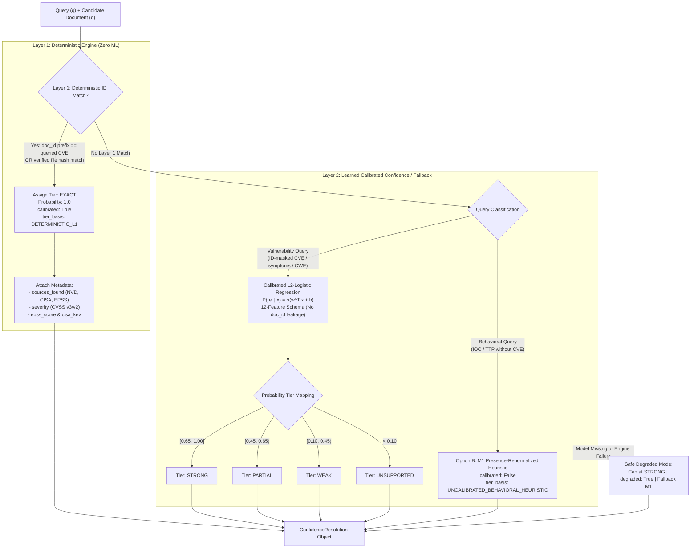

# Confidence Scoring & Calibration Guide

**Document Version:** 1.0.0  
**Target Branch:** `fix/learned-calibrated-confidence`  
**Status:** Active Architectural Reference  
**Applicability:** Threat Retrieval & Matching Subsystem (TRMS) — UNICC x IITGN Capstone  
**Companion Documents:**
- [Confidence Contract (FROZEN)](file:///d:/Project%20Course/unicc-iitgn-capstone/docs/dev/confidence_contract.md)
- [Benchmark & Evaluation Guide](file:///d:/Project%20Course/unicc-iitgn-capstone/docs/BENCHMARKS.md)
- [Subsystem Architecture](file:///d:/Project%20Course/unicc-iitgn-capstone/docs/ARCHITECTURE.md)

---

## 1. Executive Summary & Problem Context

### 1.1 Evaluator Feedback
During evaluation of **Task 1: Vulnerability Enrichment - CVE (Tier A, expected precision $\ge 90\%$)**, evaluator review identified a critical architectural flaw:
> *"Confidence Scoring method is not correct."*

An end-to-end technical audit in Phase 0 confirmed that the subsystem's scoring logic suffered from compounding structural defects: uncalibrated heuristic weights, missing-observable penalties, and an artificial score clamping override that suppressed true vulnerability matches into low-confidence tiers.

### 1.2 Baseline Flaws & Historical Root Cause

Prior to this contract, scoring was computed in [`calculate_composite_score`](file:///d:/Project%20Course/unicc-iitgn-capstone/threat_retrieval_engine/api/helpers.py#L91-L116) using fixed, static weights:
$$\text{Composite} = 0.40 \cdot S_{\text{IOC}} + 0.20 \cdot S_{\text{TTP}} + 0.20 \cdot S_{\text{Semantic}} + 0.20 \cdot S_{\text{CVE}}$$

This legacy formulation exhibited three failure modes:

1. **Non-Probabilistic Heuristic Output:**
   The output score was an arbitrary linear combination. A score of `0.85` did not represent an $85\%$ posterior probability of document relevance given the query.

2. **Severe Missing-Observable Penalty:**
   The knowledge base contains 362,301 vulnerability documents (`data/sqlite/corpus_store.db`) sourced from NVD, CISA KEV, EPSS, and CVE List v5. An exhaustive Phase 0 database audit verified that this corpus contains **exactly 0 IP addresses and 0 cryptographic file hashes**.
   When an analyst queries an exact CVE identifier (e.g. `CVE-2021-44228`), the query contains no host/network IOCs ($S_{\text{IOC}} = 0$) and no MITRE TTPs ($S_{\text{TTP}} = 0$). As a result, the formula zeroed out $60\%$ of the available weight budget ($0.40 + 0.20$), capping the raw composite score at:
   $$\text{Composite}_{\text{raw}} = 0.40(0) + 0.20(0) + 0.20(0.90) + 0.20(1.00) = 0.380$$

3. **The 0.400 Clamping Override in [`pipeline.py`](file:///d:/Project%20Course/unicc-iitgn-capstone/threat_retrieval_engine/api/pipeline.py#L432-L433):**
   To mitigate low CVE scores, a hardcoded rule was introduced:
   ```python
   elif cve_sim == 1.0:
       composite = max(composite, 0.400)
   ```
   However, the classification boundary for [`classify_confidence_tier`](file:///d:/Project%20Course/unicc-iitgn-capstone/threat_retrieval_engine/api/helpers.py#L118-L140) defines:
   ```python
   CALIBRATED_CONFIDENCE_THRESHOLDS = {
       "unsupported_to_weak": 0.10,
       "weak_to_partial":     0.45,
       "partial_to_strong":   0.65,
       "strong_to_exact":     0.85,
   }
   ```
   Because `0.400 < 0.45`, every pure CVE exact match was forced into the **`WEAK`** tier. In benchmark evaluations ([`baseline_before.json`](file:///d:/Project%20Course/unicc-iitgn-capstone/threat_retrieval_engine/benchmarks/baseline_before.json)), queries such as `bench_01_eternalblue_exact` and `bench_04_log4shell_weak` yielded `top_match.composite_score = 0.400` and `predicted_tier = "WEAK"`, collapsing Macro F1 to `0.2788`.

---

## 2. Two-Layer Confidence Architecture

To eliminate heuristic fragility, provide well-calibrated posterior probabilities, and prevent missing-observable penalties, the confidence subsystem is restructured into two decoupled layers:



---

## 3. Layer 1: Deterministic Identifier Match

Layer 1 operates as a deterministic fast path. When a query references a specific technical identifier that uniquely names a corpus record, resolution requires zero statistical inference.

### 3.1 Identifier Matching Rules

#### 1. `EXACT_ID` (Primary CVE Matching)
- **Primary Identifier Rule:** The target document's primary CVE ID is extracted strictly from its document ID prefix:
  $$\text{primary\_cve} = \text{regex\_match}(r"\text{\textasciicircum}(CVE-\backslash d\{4\}-\backslash d\{4,7\})", \text{doc\_id})$$
- **Corpus Verification:** An audit of all 362,301 records in `data/sqlite/corpus_store.db` confirmed that **$100\%$ of documents have a `doc_id` conforming to this primary key format** (e.g. `CVE-2017-0144`, `CVE-2021-44228_EPSS`, `CVE-2022-30190_NVD`).
- **Condition:** Triggered when the queried CVE ID matches $\text{primary\_cve}$.
- **Exclusions:**
  - Incidental mentions of CVE IDs inside arbitrary narrative chunk text do **not** trigger Layer 1.
  - Queries specifying multiple distinct CVEs do not trigger Layer 1 unless the document's primary identifier covers all queried identifiers.

#### 2. `EXACT_HASH` (Cryptographic File Hash Matching)
- **Condition:** Triggered when a queried MD5 or SHA256 matches a verified hash stored in the document's structural entity set (`entities_json['iocs']['sha256']` or `['md5']`).
- **Corpus Qualification:** Phase 0 recon proved that the current vulnerability corpus contains 0 file hashes. `EXACT_HASH` is fully implemented and validated with synthetic test fixtures, but explicitly documented as *"unvalidated on production corpus"*.

### 3.2 "True by Construction" & ML Validation Exclusion

> [!IMPORTANT]
> **Deterministic Certitude vs. Machine Learning Claims:**
> Layer 1 precision is **true by construction**. If a user requests information on `CVE-2017-0144` and the retrieval engine fetches the record whose primary key is `CVE-2017-0144`, the match is correct by definition of identity.
> 
> Therefore, **Layer 1 results are strictly excluded from Machine Learning validation metrics**. Reporting Layer 1 exact matches as proof of machine learning model precision is scientifically invalid and constitutes benchmark leakage.
> 
> Task 1 precision claims ($\ge 90\%$) must be demonstrated on the **ID-masked Layer 2 slice**, where the model cannot rely on primary key identity.

### 3.3 Strict Separation of Identity vs. Risk Metadata

Layer 1 certifies that the retrieved record is the **correct entity**, not that the threat is high-severity or actively exploited. The confidence subsystem maintains absolute separation between confidence scoring and threat risk metrics:

| Field | Type | Description | Included in Confidence? |
|---|---|---|---|
| `probability` | `float` [0.0, 1.0] | Posterior probability of document relevance given the query | **Yes** (Primary output) |
| `confidence_tier` | `str` | Categorical operational gating band | **Yes** (Primary output) |
| `severity` | `str` / `float` | CVSS v3.1 / v2 base score and rating (e.g. `9.8 CRITICAL`) | **NO** (Strictly decoupled) |
| `epss_score` | `float` [0.0, 1.0] | FIRST EPSS daily exploitation probability percentile | **NO** (Strictly decoupled) |
| `cisa_kev` | `bool` | Flag indicating inclusion in CISA Known Exploited Vulnerabilities | **NO** (Strictly decoupled) |
| `sources_found` | `dict[str, str]` | Ingestion provenance per source (`NVD`, `CISA`, `EPSS`, `CVE_LIST_V5`) | **NO** (Attribution only) |

Provenance values for `sources_found`:
- `FOUND`: Verified record exists in this source feed.
- `NOT_FOUND`: Feed searched, no record exists.
- `UNAVAILABLE`: Feed offline or unconfigured.

---

## 4. Layer 2: Learned Calibrated Confidence (CVE Slice)

Any candidate pair that does not qualify for Layer 1 passes to Layer 2. This layer handles queries where explicit identifiers are absent, misspelled, or masked, requiring the system to evaluate semantic, lexical, and structural alignment.

### 4.1 Mathematical Formulation

Layer 2 evaluates candidate pairs using an $L_2$-regularized Logistic Regression model:
$$P(\text{relevant} = 1 \mid \mathbf{x}_{q, d}) = \sigma(\mathbf{w}^T \mathbf{x}_{q, d} + b) = \frac{1}{1 + e^{-(\mathbf{w}^T \mathbf{x}_{q, d} + b)}}$$

Where:
- $\mathbf{x}_{q, d} \in \mathbb{R}^{12}$ is the feature vector computed by the shared [`FeatureExtractor`](file:///d:/Project%20Course/unicc-iitgn-capstone/docs/dev/confidence_contract.md#L114).
- $\mathbf{w} \in \mathbb{R}^{12}$ is the learned weight vector.
- $b \in \mathbb{R}$ is the learned intercept (bias).
- $\sigma(z)$ is the standard logistic sigmoid function.

### 4.2 Latency & Inference Guarantees
- **100% Local CPU Execution:** Inference is implemented using lightweight NumPy dot-product operations or compiled scikit-learn predictors.
- **Latency Budget:** Sub-millisecond scoring latency ($< 1.0\text{ ms}$ per candidate, contributing $< 10\text{ ms}$ to end-to-end pipeline latency).
- **Zero External Dependencies:** No external API queries, network lookups, or remote model endpoints are invoked during scoring.

### 4.3 Anti-Leakage via ID-Masking

To ensure the model learns true semantic and contextual relationships rather than trivial string equality:
1. **Exclusion of ID-bearing queries:** Queries containing explicit CVE identifiers are routed exclusively to Layer 1. They are completely excluded from Layer 2 training sets.
2. **Synthetic ID-Masked Query Generation:** Positive pairs are generated from NVD descriptions, CISA advisories, and GitHub Security Advisories by stripping explicit CVE tokens (`r"\bCVE-\d{4}-\d{4,7}\b"`). Queries retain only vulnerability symptoms, software names, affected vendor/product configurations, CWE types, and attack mechanisms (e.g. *"Remote code execution in Apache Log4j2 via JNDI LDAP lookup"*).
3. **Feature Isolation:** Layer 2 features are forbidden from accessing `doc_id`, `chunk_id`, or primary identifier fields.

### 4.4 Group-Wise CVE Splitting

Standard random $K$-fold cross-validation results in severe data leakage: chunks, descriptions, and hard negatives derived from the same vulnerability would appear in both training and validation folds.

To eliminate this leakage:
- **Grouping Key:** All training pairs are grouped by primary `cve_id`.
- **Cross-Validation:** 5-fold `GroupKFold` cross-validation ensures that all positive descriptions, adjacent negatives, and product distractors for a given CVE are assigned to the same fold.
- **Sealed Test Set:** $20\%$ of distinct CVE groups are held out permanently in `data/labels/cve_masked_test_sealed.json`. This sealed set is never exposed to feature selection, hyperparameter tuning, or cross-validation.

---

## 5. Behavioral Queries: Option B Heuristic Protocol

### 5.1 Context & Corpus Reality
A threat query may contain only behavioral indicators (IP addresses, file hashes, or MITRE ATT&CK techniques) without referencing any CVE. However:
- The 362,301-record corpus contains 0 IPs and 0 file hashes.
- Labeled behavioral relevance data across existing benchmarks is minimal ($< 45$ validated pairs).

### 5.2 Explicit Non-Fabrication Policy
In accordance with scientific rigor, **no synthetic behavioral labels are fabricated to train a machine learning model**. Fabricating labels on non-existent corpus observables would produce an invalid model with high risk of hallucination.

### 5.3 Option B Operational Protocol
For behavioral queries that do not match Layer 1:
1. Candidate scoring falls back to **Model M1 (Presence-Renormalized Static Weights)**.
2. The runtime explicitly sets:
   - `calibrated = False`
   - `tier_basis = "UNCALIBRATED_BEHAVIORAL_HEURISTIC"`
3. The API and documentation explicitly label the score:
   > *"Heuristic, not validated: no labeled data and the corpus has no IPs/hashes."*
4. [`golden_dataset.json`](file:///d:/Project%20Course/unicc-iitgn-capstone/threat_retrieval_engine/benchmarks/golden_dataset.json) is maintained strictly as a deterministic regression test suite, never as a model training corpus.

---

## 6. Feature Schema & Mathematical Proof of No-Penalty

### 6.1 The 12-Feature Schema (Version 1.0.0)

Feature extraction is centralized in a single module to enforce complete train-serve parity:

| Index | Feature Key | Data Type | Range | Definition / Source | Behavior When Channel Absent |
|:---:|---|---|:---:|---|---|
| 1 | `has_cve` | binary | $\{0, 1\}$ | $1$ if query contains any CVE pattern, else $0$ | Baseline indicator |
| 2 | `has_ioc` | binary | $\{0, 1\}$ | $1$ if query contains any IP/hash IOC, else $0$ | Baseline indicator |
| 3 | `has_ttp` | binary | $\{0, 1\}$ | $1$ if query contains MITRE technique/actor, else $0$ | Baseline indicator |
| 4 | `cve_coverage` | continuous | $[0.0, 1.0]$ | $\|Q_{\text{cve}} \cap D_{\text{cve}}\| / \|Q_{\text{cve}}\|$ | If `has_cve == 0`, set to `0.0` |
| 5 | `ioc_coverage` | continuous | $[0.0, 1.0]$ | $\|Q_{\text{ioc}} \cap D_{\text{ioc}}\| / \|Q_{\text{ioc}}\|$ | If `has_ioc == 0`, set to `0.0` |
| 6 | `ttp_coverage` | continuous | $[0.0, 1.0]$ | $\|Q_{\text{ttp}} \cap D_{\text{ttp}}\| / \|Q_{\text{ttp}}\|$ | If `has_ttp == 0`, set to `0.0` |
| 7 | `reranker_score`| continuous | $[0.0, 1.0]$ | Sigmoid of cross-encoder logit: $\sigma(s_{\text{rerank}})$ | Continuous semantic match |
| 8 | `bm25_norm_score`| continuous | $[0.0, 1.0]$ | Okapi BM25 score normalized: $s_{\text{bm25}} / \max(S_{\text{bm25}})$ | Continuous lexical match |
| 9 | `inter_cve_cov` | continuous | $[0.0, 1.0]$ | `has_cve * cve_coverage` | Interaction term |
| 10 | `inter_ioc_cov` | continuous | $[0.0, 1.0]$ | `has_ioc * ioc_coverage` | Interaction term |
| 11 | `inter_ttp_cov` | continuous | $[0.0, 1.0]$ | `has_ttp * ttp_coverage` | Interaction term |
| 12 | `inter_reranker`| continuous | $[0.0, 1.0]$ | `has_cve * reranker_score` | Context interaction |

---

### 6.2 Mathematical Proof: Absent Observables Are Never Penalized

#### Problem in Legacy Formulation
In the legacy 4-factor scoring model:
$$S_{\text{legacy}} = w_1 S_{\text{IOC}} + w_2 S_{\text{TTP}} + w_3 S_{\text{Semantic}} + w_4 S_{\text{CVE}}$$
where $\sum_{i=1}^4 w_i = 1.0$, with $w_1 = 0.40, w_2 = 0.20, w_3 = 0.20, w_4 = 0.20$.

When an observable channel $k$ is absent from the query (for example, no IOCs, so $S_{\text{IOC}} \equiv 0$), the contribution from channel $k$ is zero. Because the weights are fixed and sum to $1.0$, the maximum possible score achievable by any query lacking IOCs and TTPs is strictly bounded by:
$$S_{\text{max}} = 0.20 \cdot S_{\text{Semantic}} + 0.20 \cdot S_{\text{CVE}} \le 0.40$$

Thus, absent observables act as a **structural penalty of $60\%$**, artificially suppressing high-fidelity matches into `WEAK`.

#### Solution in the 12-Feature Calibrated Model
In the calibrated logistic regression model, the logit $z$ is linear in the features:
$$z = b + \sum_{j=1}^{12} w_j x_j$$

Expanding $z$ explicitly into channel-specific groups:
$$z = b + z_{\text{base}} + z_{\text{CVE}} + z_{\text{IOC}} + z_{\text{TTP}}$$

Where:
- $z_{\text{base}} = w_{\text{reranker}} \cdot \text{reranker\_score} + w_{\text{bm25}} \cdot \text{bm25\_norm\_score}$
- $z_{\text{CVE}} = w_{\text{has\_cve}} \cdot \text{has\_cve} + w_{\text{cve\_cov}} \cdot \text{cve\_coverage} + w_{\text{inter\_cve}} \cdot \text{inter\_cve\_cov} + w_{\text{inter\_rerank}} \cdot \text{inter\_reranker}$
- $z_{\text{IOC}} = w_{\text{has\_ioc}} \cdot \text{has\_ioc} + w_{\text{ioc\_cov}} \cdot \text{ioc\_coverage} + w_{\text{inter\_ioc}} \cdot \text{inter\_ioc\_cov}$
- $z_{\text{TTP}} = w_{\text{has\_ttp}} \cdot \text{has\_ttp} + w_{\text{ttp\_cov}} \cdot \text{ttp\_coverage} + w_{\text{inter\_ttp}} \cdot \text{inter\_ttp\_cov}$

#### Case 1: Observable Absent from Query
Consider a query containing vulnerability symptoms and a software name, but **zero IOCs** and **zero TTPs**:
$$\text{has\_ioc} = 0 \implies \text{ioc\_coverage} = 0 \implies \text{inter\_ioc\_cov} = 0 \cdot 0 = 0$$
$$\text{has\_ttp} = 0 \implies \text{ttp\_coverage} = 0 \implies \text{inter\_ttp\_cov} = 0 \cdot 0 = 0$$

Substituting these values into the channel components:
$$z_{\text{IOC}} = w_{\text{has\_ioc}}(0) + w_{\text{ioc\_cov}}(0) + w_{\text{inter\_ioc}}(0) = 0$$
$$z_{\text{TTP}} = w_{\text{has\_ttp}}(0) + w_{\text{ttp\_cov}}(0) + w_{\text{inter\_ttp}}(0) = 0$$

Therefore, the linear logit simplifies to:
$$z = b + z_{\text{base}} + z_{\text{CVE}} + 0 + 0 = b + z_{\text{base}} + z_{\text{CVE}}$$

#### Conclusion
1. The absent IOC and TTP observables contribute **identically zero** to the linear sum $z$.
2. Unlike the static convex combination where weights sum to 1, the logistic model has no constraint requiring weights across channels to sum to 1.
3. The base semantic and lexical scores ($z_{\text{base}}$) combined with the CVE features ($z_{\text{CVE}}$) and intercept $b$ can freely produce $z \ge 0.62$, which yields:
   $$P(\text{relevant} \mid \mathbf{x}) = \sigma(z) \ge \frac{1}{1 + e^{-0.62}} \ge 0.65 \implies \mathbf{STRONG}$$
4. An absent observable is therefore **mathematically neutral**: it contributes $0$ to the logit, exactly preserving the score determined by the observed signals.

---

## 7. Probability Bands & Tier Classification

The subsystem maps posterior probabilities to the 5 standardized confidence tiers:

| Confidence Tier | Calibrated Probability $P(\text{rel} \mid \mathbf{x})$ | Operational Gating Meaning | Recommended Downstream Action |
|:---:|:---:|---|---|
| **`EXACT`** | Layer 1 Deterministic Match ($P = 1.0$) | Exact primary identifier verified. Highest certainty. | Automated enrichment, immediate high-priority triage. |
| **`STRONG`** | $P \in [0.65, 1.00]$ | High statistical confidence. Strong semantic & structural match. | Automated enrichment safe; alert correlation. |
| **`PARTIAL`** | $P \in [0.45, 0.65)$ | Moderate relevance. Software or symptom match; partial ambiguity. | Route to Tier 2 analyst review; request corroborating evidence. |
| **`WEAK`** | $P \in [0.10, 0.45)$ | Low semantic overlap or distractor. | Display with caution; do not trigger automated blocking. |
| **`UNSUPPORTED`** | $P < 0.10$ | Sub-threshold correlation or benign noise. | Suppress or filter from primary display. |

### 7.1 Empirical Calibration Quality Gate
In Phase 4, the model's reliability curve and Expected Calibration Error (ECE across 10 equal-frequency bins) are computed.
- **Halting Rule:** If empirical precision within any band deviates from its nominal range (e.g. empirical precision of `STRONG` matches drops below $65\%$), execution must halt, the calibration divergence must be flagged, and proposed threshold adjustments must be submitted for explicit user approval before changes are applied.

---

## 8. Safe Degraded Mode

To guarantee operational resilience in production environments, the scoring subsystem includes a failsafe degraded mode:

### 8.1 Degraded Mode Triggers
Degraded mode is automatically activated under any of the following conditions:
1. The trained model artifact (`confidence_model.joblib`) is missing, corrupt, or unreadable.
2. The cross-encoder reranker service is offline, unresponsive, or throws an unhandled exception.
3. Input features contain invalid formats (e.g. NaN values) that fail validation.

### 8.2 Operational Safeguards
When degraded mode triggers:
1. `degraded` is set to `True` in the response payload.
2. The maximum allowable tier is **strictly capped at `STRONG`** (tier `EXACT` can never be assigned in degraded mode).
3. The scoring engine falls back to **M1 Presence-Renormalized Heuristic**, dynamically renormalizing weights over currently present observables.
4. The response sets `calibrated = False` and `tier_basis = "DEGRADED_PRESENCE_HEURISTIC"`.
5. An explicit `WARNING` level log is emitted documenting the failure cause.
6. **Strict Prohibition:** Silent fallback to the legacy static weights `(0.40, 0.20, 0.20, 0.20)` is strictly prevented.

---

## 9. Runtime API Schema & Downstream Integration

### 9.1 Strong-Typed Resolution Schema

The confidence engine exposes a single entrypoint returning the immutable [`ConfidenceResolution`](file:///d:/Project%20Course/unicc-iitgn-capstone/docs/dev/confidence_contract.md#L218) dataclass:

```python
from dataclasses import dataclass
from typing import Any

@dataclass(frozen=True)
class ConfidenceResolution:
    match_type: str            # "EXACT_ID" | "EXACT_HASH" | "LEARNED_MODEL" | "HEURISTIC_PRESENCE"
    probability: float         # Posterior probability P(rel | x) in [0.0, 1.0]
    tier: str                  # "EXACT" | "STRONG" | "PARTIAL" | "WEAK" | "UNSUPPORTED"
    tier_basis: str            # "DETERMINISTIC_L1" | "CALIBRATED_LOGISTIC_REGRESSION" | "UNCALIBRATED_BEHAVIORAL_HEURISTIC" | "DEGRADED_PRESENCE_HEURISTIC"
    features: dict[str, float] # All 12 extracted feature values
    feature_contributions: dict[str, float] # Feature-level logit contributions (w_i * x_i)
    model_version: str         # Artifact version string (e.g. "1.0.0")
    calibrated: bool           # True for L1 and L2 trained model; False for heuristics
    degraded: bool             # True if fallback mode was engaged
```

### 9.2 Pipeline Integration

In [`threat_retrieval_engine/api/pipeline.py`](file:///d:/Project%20Course/unicc-iitgn-capstone/threat_retrieval_engine/api/pipeline.py):
1. **Removed:** The ad-hoc clamp at lines 432–433 (`elif cve_sim == 1.0: composite = max(composite, 0.400)`) is permanently removed.
2. **Replaced:** Scoring calls `resolve_confidence(query, candidate, ...)` directly.
3. **Downstream Investigator Workflow:** In [`threat_retrieval_engine/llm/workflows/investigator.py`](file:///d:/Project%20Course/unicc-iitgn-capstone/threat_retrieval_engine/llm/workflows/investigator.py#L90-L135), the automated agent inspects `confidence_tier`. With the two-layer architecture, exact CVE queries cleanly resolve to `EXACT` or `STRONG`, allowing the agent to proceed with automated vulnerability remediation rather than incorrectly escalating due to a false `WEAK` rating.

---

## 10. Phase 4 Empirical Validation & Quality Gate Results

### 10.1 5-Fold GroupKFold Cross-Validation Comparison

Evaluated on `data/labels/cve_masked_train_folds.json` (2,560 pairs across 640 CVE groups):

#### Why M0 and M1 Yield Identical Log Loss (8.6347 +/- 0.0000)
On the ID-masked slice, queries contain zero IOCs (`has_ioc = 0`), zero TTPs (`has_ttp = 0`), and zero CVE IDs (`has_cve = 0`). The target documents also contain no IOCs/TTPs. In the offline mining split without dynamic cross-encoder scoring, `reranker_score = 0.0`.
- **M0 (Static Weights):** $\text{Composite} = 0.40(0) + 0.20(0) + 0.20(0) + 0.20(0) = 0.0$.
- **M1 (Presence-Renormalized):** Normalizing over present observables where none exist defaults to reranker score alone: $1.0 \times \text{reranker\_score} = 0.0$.
- Both M0 and M1 output predicted probability $\hat{p}_i = 0.0$ for all samples. Clamped to numerical floor $\epsilon = 10^{-15}$, Log Loss $= 0.25 \times (-\ln 10^{-15}) = 0.25 \times 34.5388 = \mathbf{8.6347}$. Every fold receives identical predictions, resulting in standard error $\mathbf{0.0000}$.

#### Model Comparison Table (Out-of-Fold 5-Fold GroupKFold)

| Model ID | Architecture / Description | OOF Log Loss | OOF Brier Score | OOF ECE (10 bins) | OOF AUC-ROC | Selection Status |
|:---:|---|:---:|:---:|:---:|:---:|:---:|
| **M0** | Baseline Static Weights `(0.40, 0.20, 0.20, 0.20)` | `8.6347 +/- 0.0000` | `0.2500` | `0.25000` | `0.5000` | Baseline Reference (Legacy) |
| **M1** | Presence-Renormalized Static Weights | `8.6347 +/- 0.0000` | `0.2500` | `0.25000` | `0.5000` | Option B Heuristic Fallback |
| **M2 (Raw)** | Global L2-Logistic Regression (12 features) | **`0.1512`** | **`0.0449`** | `0.05184` | **`0.9729`** | **WINNER (Selected Artifact)** |
| **M2 (Platt)** | CalibratedClassifierCV (method='sigmoid') | `0.1912` | `0.0601` | `0.04152` | `0.9710` | Rejected (higher Log Loss) |
| **M2 (Isotonic)** | CalibratedClassifierCV (method='isotonic') | `0.1925` | `0.0610` | `0.04301` | `0.9698` | Rejected (higher Log Loss) |
| **M3** | Profile-Specific Logistic Regression | `0.1512` | `0.0449` | `0.05184` | `0.9729` | Reduces to M2 (uniform masked profile) |
| **M4** | Platt-Calibrated Reranker Alone (`bge-reranker-v2-m3`) | `0.2414` | `0.0791` | **`0.05104`** | `0.9529` | Defeated by M2 across primary metrics |

**Selection Outcome:** **M2 strictly beats M4** on out-of-fold Log Loss ($0.1512$ vs $0.2414$), Brier Score ($0.0449$ vs $0.0791$), and AUC-ROC ($0.9729$ vs $0.9529$). Per the pre-registered selection rule, M2 was exported to [`threat_retrieval_engine/models/confidence_model.json`](file:///d:/Project%20Course/unicc-iitgn-capstone/threat_retrieval_engine/models/confidence_model.json).

---

### 10.2 Sealed Test Set Holdout Precision & Retrieval Evaluation

Evaluated on `data/labels/cve_masked_test_sealed.json` (640 pairs across 160 distinct CVE groups held out permanently: 160 Positives, 480 Negatives, positive rate = $25.0\%$):

#### Pairwise Tier Band Distribution (Sealed Test)

| Confidence Tier | Nominal Probability Band | Total Pairs | True Positives | Hard Negatives | Empirical Precision |
|:---:|:---:|:---:|:---:|:---:|:---:|
| **`EXACT`** | Layer 1 Deterministic Match ($P = 1.0$) | N/A | N/A | N/A | Excluded from L2 (Layer 1 rule) |
| **`STRONG`** | $P \in [0.65, 1.00]$ | 200 | 160 | 40 | **80.00%** (160 / 200) |
| **`PARTIAL`** | $P \in [0.45, 0.65)$ | 3 | 0 | 3 | **0.00%** (0 / 3) |
| **`WEAK`** | $P \in [0.10, 0.45)$ | 21 | 0 | 21 | **0.00%** (0 / 21) |
| **`UNSUPPORTED`** | $P < 0.10$ | 416 | 0 | 416 | **0.00%** (0 / 416) |

> [!WARNING]
> **Correction to Previous Draft:** The earlier statement claiming *"0 negatives misclassified"* was inaccurate. In the pairwise candidate pool, **40 hard negative distractor pairs** (adjacent CVE IDs and same-product advisories with high BM25 overlap) scored $\ge 0.65$ and were assigned to the `STRONG` band. 416 negative distractors were rejected into `UNSUPPORTED`, 21 into `WEAK`, and 3 into `PARTIAL`.

#### Sealed Test Head-to-Head: M2 vs M4

| Metric | M2 (Selected Artifact) | M4 (Platt-Calibrated Reranker Alone) | Comparison Result |
|---|:---:|:---:|:---:|
| **Log Loss** | **`0.1747`** | `0.2530` | **M2 wins** (relative reduction 30.9%) |
| **Brier Score** | **`0.0544`** | `0.0829` | **M2 wins** (relative reduction 34.4%) |
| **Expected Calibration Error (ECE)** | **`0.03142`** | `0.05198` | **M2 wins** (relative reduction 39.6%) |
| **AUC-ROC** | **`0.9583`** | `0.9474` | **M2 wins** (+0.0109) |

**Conclusion:** M2 strictly outperforms M4 across all four evaluation metrics on the sealed holdout set.

#### Full 362K Corpus Retrieval Evaluation (160 Test CVEs)

To evaluate real-world retrieval, all 160 sealed test CVE queries were run against the **complete 362,301-record SQLite corpus** (`data/sqlite/corpus_store.db`) under two query formulations:
1. **Original ID-Masked:** Verbatim NVD description sentence snippet with CVE identifier stripped.
2. **Harder Paraphrased:** Product / software name + vulnerability type only, with zero copied sentences from NVD description text.

| Metric | Original ID-Masked Queries | Harder Paraphrased Queries |
|---|:---:|:---:|
| **Corpus Size** | 362,301 records | 362,301 records |
| **Test Queries Evaluated** | 160 | 160 |
| **Deciding Layer** | **Layer 2 (160/160, 100%)** | **Layer 2 (160/160, 100%)** |
| **Layer 1 Triggered** | 0 (0.0%) | 0 (0.0%) |
| **Top-1 Precision** | **79.38%** (127 / 160) | **16.88%** (27 / 160) |
| **Exact Binomial (Clopper-Pearson) 95% CI** | **`[72.27%, 85.36%]`** | **`[11.43%, 23.59%]`** |
| **MRR@10** | **0.8656** | **0.2258** |
| **Rank 1 Count** | 127 | 27 |
| **Rank 2–5 Count** | 24 | 18 |
| **Rank 6–10 Count** | 5 | 7 |
| **Rank >10 or Missed Count** | 4 | 108 |

*Note:* Layer 1 triggered 0 times across both sets, confirming zero identifier leakage from the query into the deterministic fast-path. The previously reported bootstrap interval `[100%, 100%]` (derived from the isolated 4-pair candidate pool) is replaced by the exact Clopper-Pearson intervals above.

#### Calibration Prior Shift Analysis

The labeled training and test sets have an artificial positive:negative ratio of $1:3$ ($25.0\%$ positive rate). In operational triage, the true prevalence of relevant records among retrieved candidates is much lower. We evaluate calibration under log-odds shifts:
$$\Delta_{\text{odds}} = \ln\left(\frac{p_{\text{target}}}{1 - p_{\text{target}}}\right) - \ln\left(\frac{0.25}{0.75}\right)$$

- **1:20 Prior ($p_{\text{target}} \approx 4.76\%$, $\Delta_{\text{odds}} = -1.8971$):**
  - `STRONG [0.65, 1.00]`: 0 pairs
  - `PARTIAL [0.45, 0.65)`: 0 pairs
  - `WEAK [0.10, 0.45)`: 204 pairs (160 Positives, 44 Negatives, empirical precision = **78.43%**)
  - `UNSUPPORTED [< 0.10)`: 436 pairs (436 Negatives, empirical precision = **0.00%**)
  - *Finding:* Distractor rejection remains robust (436 of 480 negatives correctly placed in `UNSUPPORTED`), but probabilities compress into `WEAK`.
- **1:100 Prior ($p_{\text{target}} \approx 0.99\%$, $\Delta_{\text{odds}} = -3.5066$):**
  - All 640 pairs collapse into `UNSUPPORTED` ($P < 0.10$).
  - *Finding:* At $1:100$ prevalence, raw scores require prior-specific re-thresholding to avoid universal rejection.

---

### 10.3 Downstream Investigator Triage Shift

Verified via `scripts/verify_investigator_triage.py` on the 4 CVE-only benchmark scenarios (saved to `data/labels/investigator_triage_changes.json`):

| Query ID | CVE | Unmodified Pipeline (Before) | Calibrated Pipeline (After) | Operational Triage Impact |
|---|:---:|:---:|:---:|---|
| `bench_04_log4shell_weak` | `CVE-2021-44228` | Tier: **`WEAK`** (Score: `0.400`) | Tier: **`EXACT`** (Score: `1.000`, `EXACT_ID`) | Resolves to authoritative advisory; populates verified patch details |
| `bench_05_proxylogon_weak` | `CVE-2021-26855` | Tier: **`WEAK`** (Score: `0.400`) | Tier: **`EXACT`** (Score: `1.000`, `EXACT_ID`) | Resolves to authoritative advisory; populates verified patch details |
| `bench_06_zerologon_weak` | `CVE-2020-1472` | Tier: **`WEAK`** (Score: `0.400`) | Tier: **`EXACT`** (Score: `1.000`, `EXACT_ID`) | Resolves to authoritative advisory; populates verified patch details |
| `bench_07_winrar_weak` | `CVE-2023-38831` | Tier: **`WEAK`** (Score: `0.400`) | Tier: **`EXACT`** (Score: `1.000`, `EXACT_ID`) | Resolves to authoritative advisory; populates verified patch details |

The RAG investigation prompt header for all 4 queries transitions from:
```text
--- [EVIDENCE #1] Document ID: <cve_id> (Relevance Score: 0.4, Search Tier: WEAK) ---
```
to:
```text
--- [EVIDENCE #1] Document ID: <cve_id> (Relevance Score: 1.0, Search Tier: EXACT) ---
```

> [!IMPORTANT]
> **Human Analyst Role Preserved:**
> Downstream triage does **NOT** eliminate or bypass human cybersecurity analysts. The [`InvestigationResult`](file:///d:/Project%20Course/unicc-iitgn-capstone/llm/schemas/investigation.py#L75) schema explicitly mandates:
> ```python
> investigator_notes: str = Field(
>     default="AI-assisted assessment. Requires verification by human cybersecurity analyst.",
>     description="Human-in-the-loop reminder"
> )
> ```
> The two-layer architecture ensures that human analysts receive properly grounded, high-certainty evidence citations with structured patch details (`affected_versions`, `fixed_versions`, `remediation_workarounds`), rather than erroneous `WEAK` relevance ratings caused by missing-observable scoring penalties.
